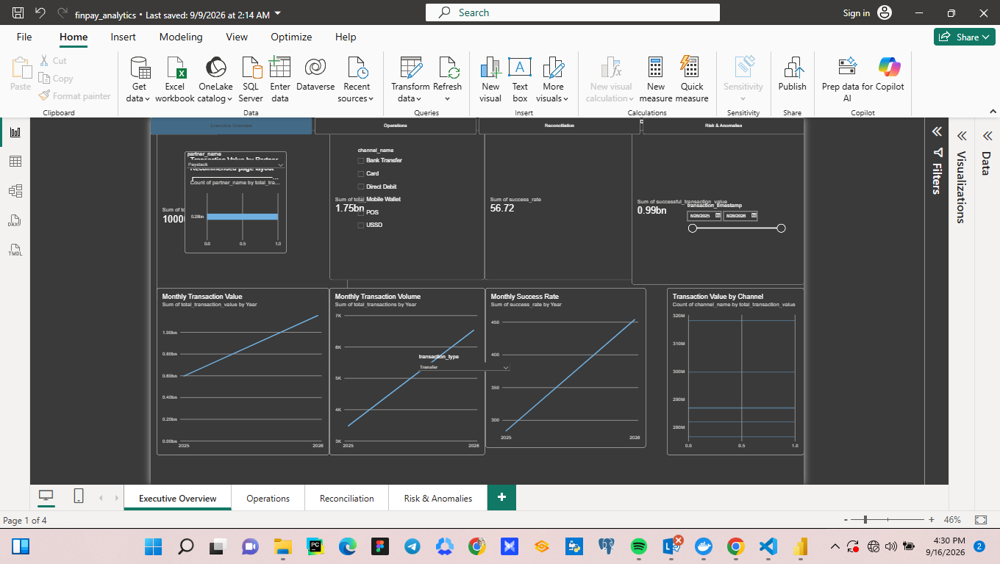
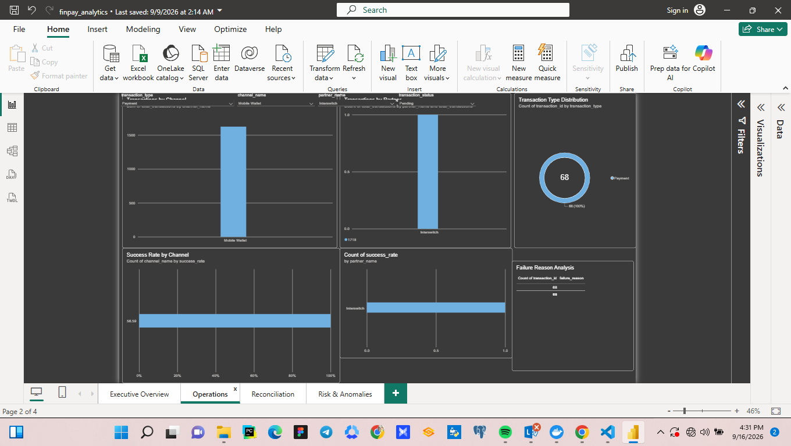
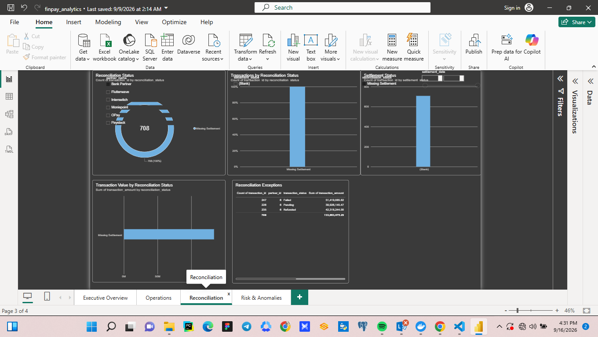
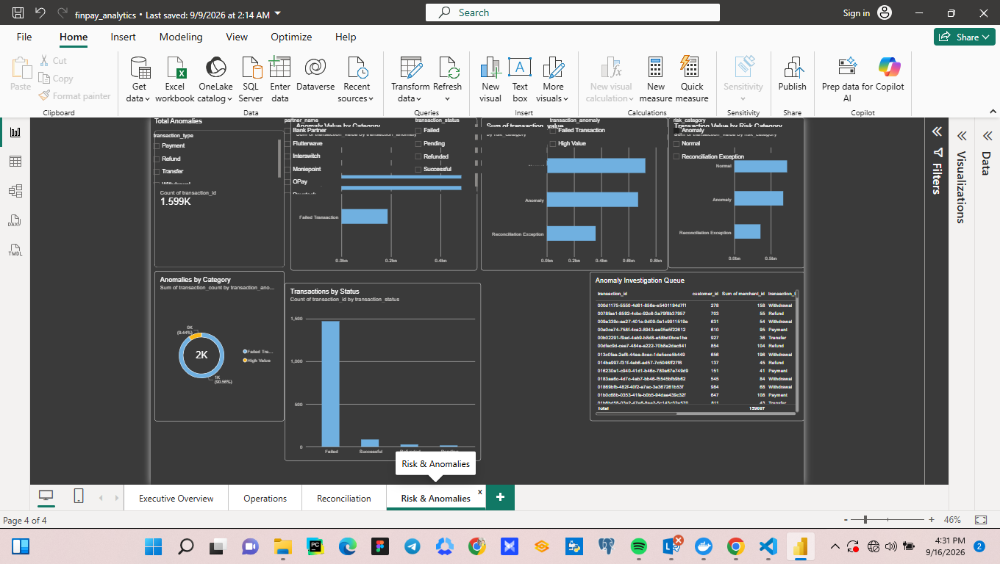
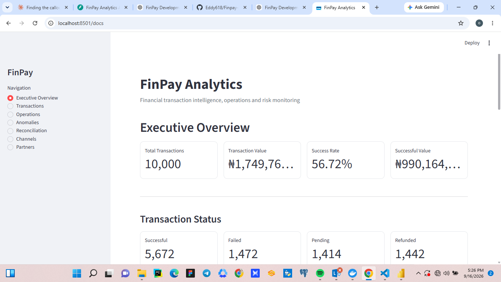

FinPay Analytics
A full-stack financial analytics and transaction intelligence platform built to demonstrate practical skills in SQL, PostgreSQL, Power BI, Python ETL, FastAPI, Streamlit, Docker, and GitHub.

Project Overview
FinPay Analytics is a simulated fintech analytics platform for monitoring transaction performance, payment channels, payment partners, reconciliation exceptions, data quality, and transaction anomalies.

The project combines a relational PostgreSQL data layer with automated Python ETL, SQL-based analytics, Power BI dashboards, a FastAPI backend, and a Streamlit application.

The goal is to demonstrate how raw financial transaction data can be transformed into reliable business intelligence and operational monitoring tools.

System Architecture
FinPay Analytics Architecture

The platform follows a layered architecture combining PostgreSQL, Python ETL, SQL analytics, Power BI, FastAPI, Streamlit, and Docker.

Business Problem
Financial institutions and payment platforms need visibility into:

## Key Business Insights

- 10,000 transactions were analyzed with total transaction value of approximately ₦1.75B.
- 5,672 transactions currently have matching settlement records, while 4,328 have no corresponding settlement record in the simulated settlement dataset.
- 1,599 transactions were flagged by the implemented anomaly-monitoring logic.
- Core transaction data passed the implemented data-quality checks with no duplicate transaction IDs, missing amounts, invalid amounts, or missing key entity references.
- The ETL pipeline supports incremental loading and records execution results in the ETL audit log.

## Dashboard Screenshots

### Executive Overview

### Operations

### Reconciliation

### Risk & Anomalies

### Streamlit Application

Transaction volume and transaction value
Successful, failed, pending, and refunded transactions
Customer and merchant performance
Payment channel performance
Payment partner performance
Settlement and reconciliation exceptions
Data-quality problems
Potentially anomalous transactions
Operational trends over time
FinPay Analytics addresses these needs through a layered analytics architecture.

Key Results
The current dataset contains:

10,000 transactions
Multiple payment channels
Multiple payment partners
Customer and merchant dimensions
Settlement data
Transaction-level anomaly detection
Reconciliation analysis
Automated data-quality validation
Incremental ETL processing
The project also identified 1,599 transaction anomalies through the implemented anomaly-monitoring logic.

The current reconciliation dataset contains:

5,672 matched transactions
4,328 transactions without settlement records
Note: the settlement exceptions are generated from the simulated settlement dataset and are intended for demonstrating reconciliation workflows rather than representing production financial data.

## Live Deployment

FinPay Analytics is deployed on Railway.

- **Dashboard:** https://finpay-analytics-production-d748.up.railway.app/
- **API Base URL:** https://finpay-analytics-production.up.railway.app
- **API Health Check:** https://finpay-analytics-production.up.railway.app/health
- **Analytics KPIs:** https://finpay-analytics-production.up.railway.app/kpis

## Technology Stack

- Python
- FastAPI
- Streamlit
- PostgreSQL
- Railway

## Security

- Production credentials are managed through Railway environment variables.
- Local `.env` files and database dumps must not be committed to Git.
- Exposed credentials must be rotated.
